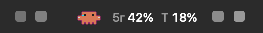
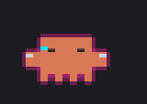
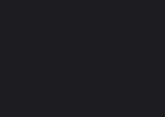
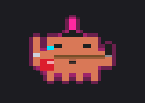
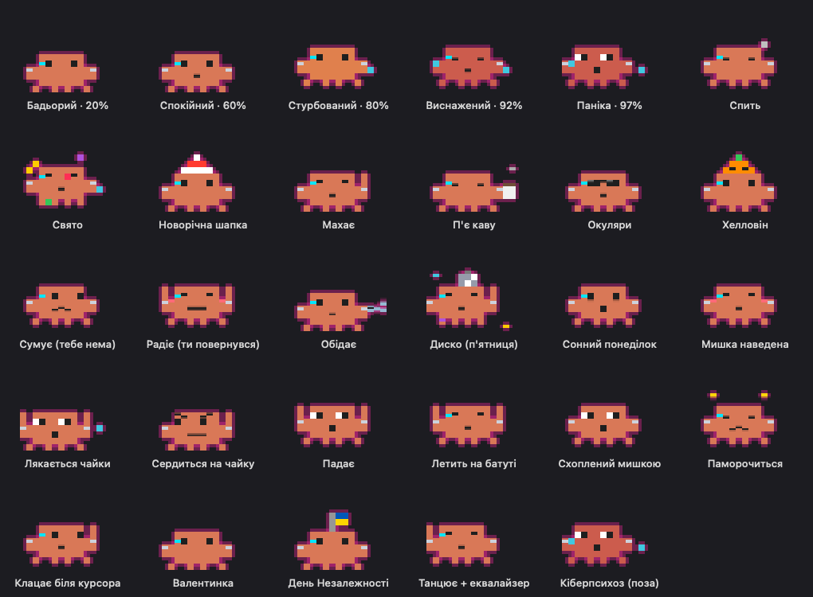
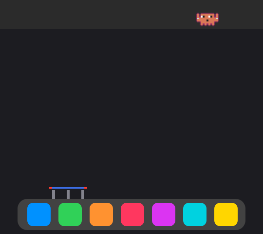
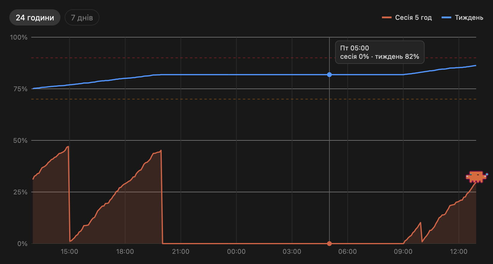

# 🦀 Limit Crab

**Тамагочі в менюбарі, яке показує, скільки ліміту Claude у тебе лишилось.**

Піксельний краб живе біля годинника й показує дві цифри: скільки використано з **5-годинної сесії** і з **тижневого** ліміту Claude.
Чим ближче до межі, тим більше він нервує: пітніє, панікує, а в кіберпанк-режимі ще й глючить і телепортується.
А коли тобі нудно, гуляє по менюбару, стрибає на батут у Dock і ловить курсор.

<p align="center">
  
</p>

<p align="center">
  
  
  
</p>

> Неофіційний особистий проєкт, не пов'язаний з Anthropic. Застосунок називається «Claude Limits», бо показує ліміти Claude. Краба намальовано з нуля в коді.

---

## Що він уміє

**Настрій за лімітами** (рахується від більшого з двох лімітів):

| До 50% | 50–75% | 75–90% | 90–95% | 95%+ |
|---|---|---|---|---|
| бадьорий | спокійний, усміхається | стурбований, піт | виснажений | паніка 😱 |

<p align="center"></p>

**Витівки й випадкові події:**
- 🚶 **гуляє** по менюбару, а на MacBook із вирізом камери **обходить його** знизу (або **ховається** за камеру);
- 🤸 **батут у Dock:** стрибає вниз, відскакує, сідає на іконку якоїсь програми й летить назад;
- 🖱️ **ловить курсор:** підстрибує до мишки й клацає клешнею;
- 🫳 його можна **схопити мишкою й кинути**: він падає, відскакує, паморочиться і повертається;
- 🐦 **чайка** пролітає, краб лякається і сердиться їй услід;
- ☕ кава зранку, 🐟 обід о 13:00, 🪩 диско в п'ятницю ввечері, 😴 сонний понеділок і сон уночі;
- 🥺 сумує, якщо тебе 10+ хвилин нема, і радіє, коли повертаєшся;
- очі стежать за мишкою, червоніє, якщо навести курсор;
- 🎉 святкує, коли ліміт скидається;
- сезонне: 🎅 шапка на Новий рік, 🎃 гарбуз і 🦇 кажан на Хелловін, ❄️ сніг узимку, 💕 сердечка 14 лютого, 🇺🇦 прапорець 24 серпня й 28 червня.

<p align="center"></p>

**Кіберпанк-режим** (вмикається в меню, за замовчуванням увімкнений): неонове світіння, імплант, неоновий слід під час руху,
**глітч** від 95% ліміту, **кіберпсихоз** (серія телепортів із променем), повернення додому **голограмою** після кидка.

**Графік використання** за 24 години або 7 днів (меню → «Графік використання…»):

<p align="center"></p>

---

## Встановлення на Mac з нуля

**Що потрібно:**
- **macOS 12 або новіша.**
- **Claude Code, у який виконано вхід.** Краб бере ліміти з твого входу в Claude Code (з Keychain), тож без нього покаже лише «…».
  Якщо Claude Code ще нема: встанови його ([інструкція](https://docs.claude.com/en/docs/claude-code/setup)), запусти в Терміналі `claude` і увійди.
- **Xcode Command Line Tools** (компілятор Swift). Ставляться однією командою, нижче.

**Кроки** (у Терміналі):

1. Компілятор (якщо ще не стоїть; відкриється вікно встановлення):
   ```bash
   xcode-select --install
   ```
2. Завантаж код і зайди в папку:
   ```bash
   git clone https://github.com/rotskerr/limit-crab.git
   ```
   ```bash
   cd limit-crab
   ```
3. Збери й встанови (з'явиться в `~/Applications/Claude Limits.app` і одразу запуститься):
   ```bash
   ./build.sh
   ```
4. Автозапуск при вході в систему:
   ```bash
   ./install-autostart.sh
   ```
5. *(Необов'язково)* Щоб краб на батуті сідав **точно** на іконки Dock: меню краба → «Дозвіл для Dock…» і увімкни
   **Системні налаштування → Приватність і безпека → Універсальний доступ → Claude Limits**. Без цього він сідає приблизно.

**Оновитись до нової версії:** `git pull`, потім знову `./build.sh`.

**Видалити:**
```bash
launchctl bootout gui/$(id -u)/local.claude.limits; rm -rf ~/Applications/"Claude Limits.app" ~/Library/LaunchAgents/local.claude.limits.plist
```

---

## Як це працює

- Раз на **5 хвилин** краб питає в сервера Anthropic, скільки ліміту використано, тим самим входом, що й Claude Code.
  Це **неофіційний** ендпоінт: він може змінитися, і тоді краб покаже помилку.
- Токен входу читається з Keychain лише для запиту й **нікуди не зберігається й не відправляється** більше нікуди.
- Сервер швидко обмежує часті запити, тому краб робить паузи (5 → 10 → 20 → 30 хв) і пам'ятає останні цифри.
- Вхід Claude Code живе ≈8 годин і оновлюється лише тоді, коли Claude Code запускається. Якщо вхід от-от спливе,
  краб **сам тихо запускає** `claude -p ok` на найдешевшій моделі (≈10 с, крихта ліміту, не частіше ніж раз на 30 хв).
- Якщо час скидання ліміту минув, а свіжих даних ще нема, краб показує ліміт як «скинувся», а не старі цифри.
- Сну Мака не блокує. Удома ≈1.5% одного ядра, під час сцен (30 кадрів/с) ≈3%.

**Меню краба** (клік по ньому): ліміти й час до скидання, графік, перемикач кіберпанк-режиму, «Дебаг: стани краба»
(подивитися будь-який стан і запустити будь-яку сцену просто зараз), «Оновити зараз».

---

## Windows

Є й версія для Windows: великий краб на панелі задач (папка [`windows/`](windows/README.md)).
Збирається вбудованим у Windows компілятором: двічі клікни `windows/build.cmd`.

---

Ліцензія: [MIT](LICENSE).
